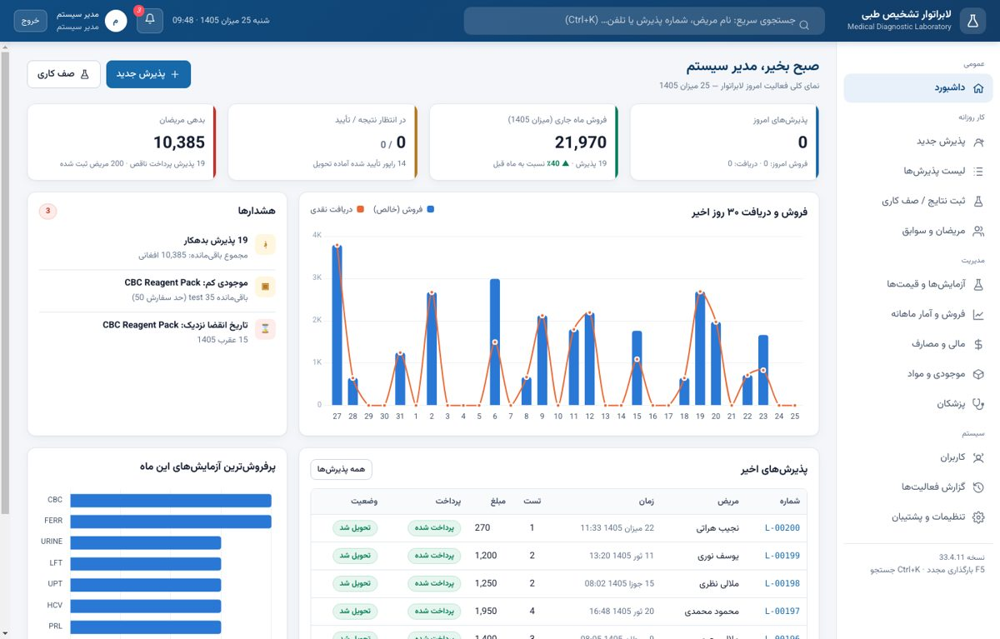
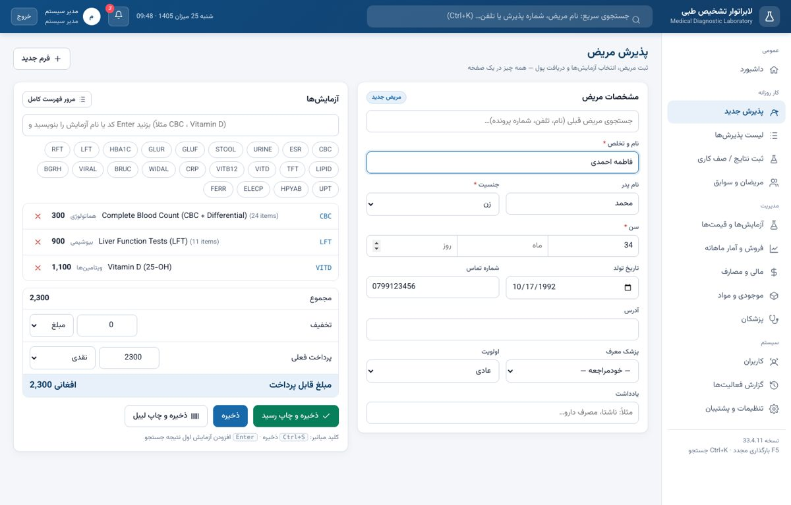
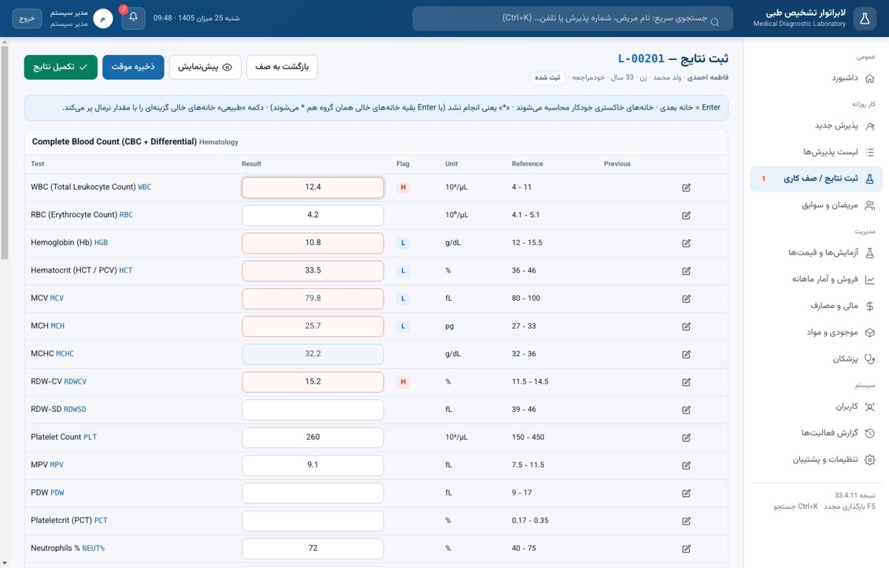
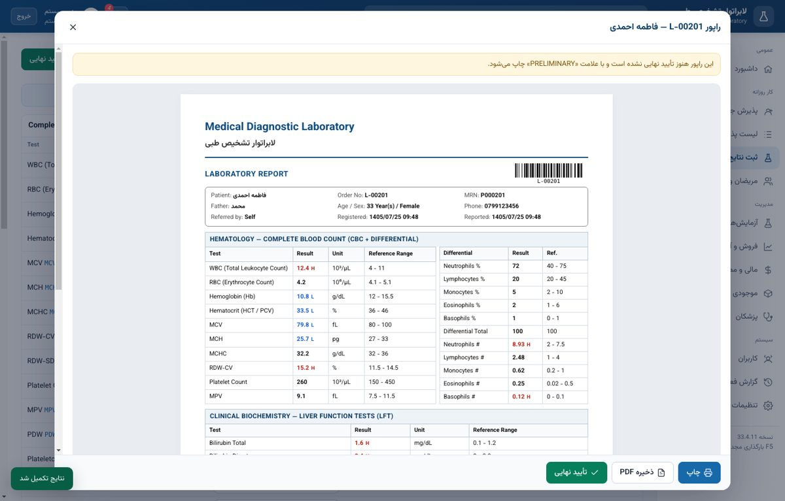
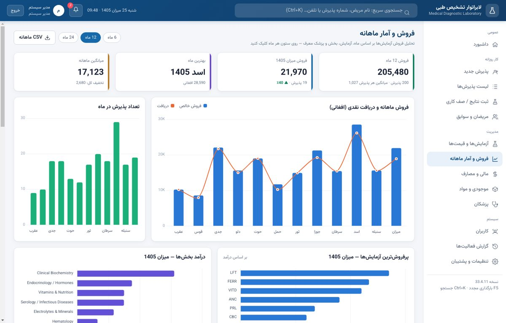
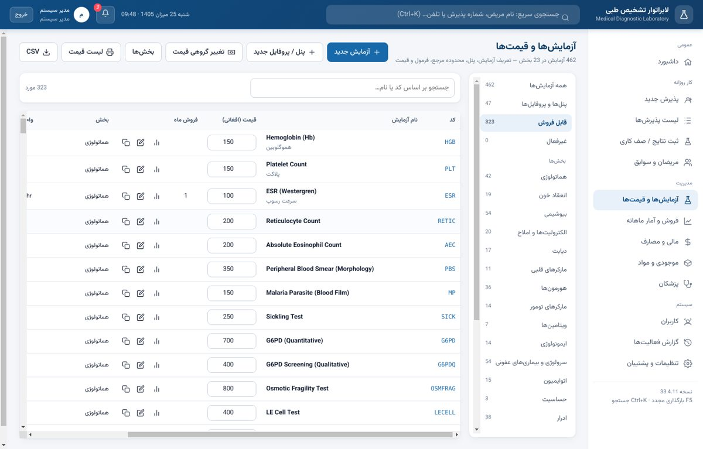
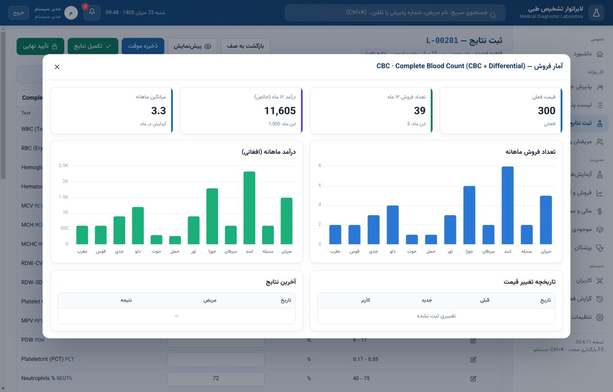

# Clinical Laboratory System — سیستم مدیریت لابراتوار

A complete **desktop Laboratory Information System (LIS)** for Windows (also Linux/macOS), built with Electron and a real **SQLite database**. Interface in Dari (RTL), reports in English — like most clinical labs in Afghanistan.



## Download

| | |
|---|---|
| **Windows installer** | `ClinicalLab-Setup-x.y.z.exe` — from the **Actions** tab → latest *Build desktop app* run → artifact **ClinicalLab-Windows** (or from **Releases** when a `v*` tag is pushed) |
| **Windows portable** | `ClinicalLab-Portable-x.y.z.exe` — same artifact, runs without installing |
| **Windows zip** | `ClinicalLab-x.y.z-win-x64.zip` — unzip and run `Clinical Laboratory System.exe` |
| **Linux** | `*.AppImage` — artifact **ClinicalLab-Linux** |

First login: **admin / 1234** (you are asked to change it immediately).

## Features

**Daily work**
- **Reception** — new or returning patient (search by name / phone / file no.), age in years-months-days, referring doctor, urgent flag, test search by code or name with keyboard (↑ ↓ Enter), quick buttons for common tests, full catalog browser, discount (amount or %), partial payment, receipt and **barcode sample labels**.
- **Worklist & result entry** — pending / ready-to-approve / approved queues, urgent first. Grouped result sheet per panel, **automatic calculations** (MCV, MCH, MCHC, absolute counts, indirect bilirubin, globulin, A/G ratio, BUN, eGFR CKD-EPI 2021, LDL/VLDL, anion gap, TSAT, INR, HOMA-IR, eAG, ACR, PSA ratio…), live **H / L / critical (HH/LL) / abnormal** flags, **sex- and age-specific reference ranges**, previous result of the same patient (delta check), per-test comments, “Normal” button for urine/stool, `*` = not done.
- **Approval workflow** — registered → sampled → in progress → completed → **approved (locked)** → delivered. Un-approving needs a reason and is logged.
- **A4 report** (print / PDF) with lab logo, barcode, patient box, CBC + differential side by side, flags, comments, signature. Receipt (80 mm) and tube labels.

**Management**
- **Tests & prices** — 462 entries (415 tests + 47 panels / profiles) in 23 departments. Add / edit / copy tests and panels (nested panels supported), result type (numeric / option / text / long text), units, decimals, critical limits, formulas, **multiple reference ranges by sex & age**, consumables, inline price editing, **bulk price update** (% / fixed / round), **price history**, printable price list, CSV export.
- **Per-test chart** — monthly quantity and monthly revenue for the last 12 months, price history, latest results.
- **Monthly sales** — sales vs. cash collected per month, orders per month, best month, top tests and department revenue for any month (click a bar), a **test × month sales matrix** (quantity or revenue) with CSV export, doctor referrals with commission.
- **Finance** — income by payment method, expenses by category, net cash profit (with optional tax %), debts list with quick payment, refunds, **daily cash closing report**.
- **Inventory** — kits/reagents/consumables, stock in/out, lot & expiry, low-stock and expiry alerts, suppliers; reagents linked to tests are **deducted automatically** when results are completed.
- **Patients** — full history, totals, debts, **result trend chart** with the reference band.
- **Doctors**, **users & roles** (admin, reception, lab, finance, doctor), **audit log**, alerts bell, global search (Ctrl+K), solar (حمل، ثور…) or Gregorian calendar.
- **Backup** — automatic daily backup (keeps the last N), manual backup/restore of the `.sqlite` file, demo-data generator for training.

| Reception | Result entry |
|---|---|
|  |  |
| **Report** | **Monthly sales** |
|  |  |
| **Tests & prices** | **Per-test sales chart** |
|  |  |

## The database

SQLite (via [sql.js](https://github.com/sql-js/sql.js) — no native build). The file is stored at
`%APPDATA%\Clinical Laboratory System\data\laboratory.sqlite` (backups in `…\data\backups`).

Files in [`database/`](database):
- `schema.sql` — the full schema
- `seed-catalog.sql` — the default catalog as SQL inserts
- `laboratory-empty.sqlite` — a ready database with the catalog (open with DB Browser for SQLite)
- `test-catalog.csv` — the catalog as a spreadsheet

| Table | Purpose |
|---|---|
| `settings` | lab info, numbering, currency, calendar, report options, ISI / PT control |
| `users`, `audit_log` | accounts (PBKDF2 hashed passwords), roles, activity log |
| `departments`, `sample_types` | catalog structure |
| `tests` | every test and panel: code, names, unit, ranges, critical values, formula, price, cost, TAT |
| `panel_items` | panel → component mapping (nested panels allowed) |
| `reference_ranges` | ranges by sex and age (days) |
| `price_history` | every price change |
| `patients`, `doctors` | people |
| `orders`, `order_items` | receptions and the tests sold (price at time of sale) |
| `results` | one row per test result with flag, printed range and unit |
| `payments` | payments and refunds |
| `expenses` | lab expenses |
| `inventory_items`, `inventory_tx`, `suppliers`, `test_consumables` | stock and automatic reagent use |
| views `v_order_summary`, `v_test_sales_monthly`, `v_monthly_finance`, `v_low_stock` | reporting |

### Catalog (default)

| Department | Tests | Panels |
|---|---|---|
| Hematology | 39 | 3 |
| Coagulation | 16 | 3 |
| Clinical Biochemistry (liver, kidney, lipids, enzymes, proteins, check-up packages) | 44 | 10 |
| Electrolytes & Minerals (incl. iron profile, bone profile) | 17 | 3 |
| Diabetes | 14 | 3 |
| Cardiac Markers | 10 | 1 |
| Endocrinology / Hormones | 31 | 5 |
| Tumor Markers | 13 | 1 |
| Vitamins & Nutrition | 7 | — |
| Immunology & Inflammation | 12 | 2 |
| Serology / Infectious Diseases (hepatitis, HIV, TORCH, Widal, Brucella, dengue…) | 47 | 7 |
| Autoimmune | 15 | — |
| Allergy | 3 | — |
| Urinalysis | 36 | 2 |
| Stool Examination | 18 | 1 |
| Microbiology (cultures, Gram, AFB, KOH) | 17 | — |
| Blood Bank | 6 | 1 |
| Body Fluids (CSF, pleural/ascitic) | 13 | 2 |
| Andrology / Semen (WHO 2021) | 14 | 1 |
| Drug Monitoring & Toxicology (incl. urine drug screen) | 20 | 1 |
| Molecular Diagnostics (PCR, GeneXpert) | 11 | — |
| Blood Gases | 6 | 1 |
| Histopathology & Cytology | 6 | — |

> ⚠️ **Prices are placeholders in AFN and reference ranges are common adult textbook values.** Every laboratory must check them against its own analyzers and kit inserts before clinical use — everything is editable under *آزمایش‌ها و قیمت‌ها*.

### Formulas

Calculated tests use `{CODE}` for other results, variables `AGE`, `FEMALE`, `ISI`, `PTC`, and functions `pow, min, max, abs, sqrt, exp, ln, log10, round, egfr`. Examples: `{HCT}*10/{RBC}`, `{CHOL}-{HDL}-{TG}/5`, `pow({PT}/PTC,ISI)`, `egfr({CREA},AGE,FEMALE)`.

## Run from source

```bash
npm install
npm start            # run the app
npm test             # database self-test
npm run build:win    # Windows installer + portable (on Windows, or Linux with wine)
npm run export-db    # regenerate files in database/
```

Project layout: `main.js` (Electron main + IPC), `preload.js` (secure bridge), `src/` (schema, catalog, database layer), `renderer/` (UI: `js/pages/*` one file per screen), `scripts/` (tests, export, UI screenshot test).

---

## راهنمای کوتاه (دری)

- **نصب:** فایل `ClinicalLab-Setup.exe` را اجرا کنید یا نسخه پرتابل را مستقیم باز کنید. ورود اول: `admin` و رمز `1234` (فوراً تغییر دهید).
- **پذیرش:** نام، جنس و سن مریض را بنویسید، آزمایش را با کد یا نام جستجو و Enter بزنید، تخفیف و پرداخت را وارد و «ذخیره و چاپ رسید» را بزنید.
- **ثبت نتایج:** از «صف کاری» پذیرش را باز کنید؛ خانه‌های خاکستری خودکار محاسبه می‌شوند، H/L خودکار نشان داده می‌شود؛ «تکمیل نتایج» و سپس «تأیید نهایی» و چاپ A4.
- **آزمایش‌ها و قیمت‌ها:** قیمت را مستقیم در جدول تغییر دهید یا «تغییر گروهی قیمت» را بزنید؛ آزمایش یا پنل جدید بسازید، محدوده مرجع بر اساس سن و جنس تعریف کنید؛ آیکون نمودار، فروش ماهانه هر آزمایش را نشان می‌دهد.
- **فروش و آمار ماهانه:** فروش هر ماه، دریافت نقدی، پرفروش‌ترین آزمایش‌ها و جدول فروش هر آزمایش در هر ماه.
- **پشتیبان:** هر روز خودکار؛ از «تنظیمات و پشتیبان» می‌توانید نسخه پشتیبان بگیرید یا بازیابی کنید.

Made by Mostafa Mesbah Aabedi · MIT License
